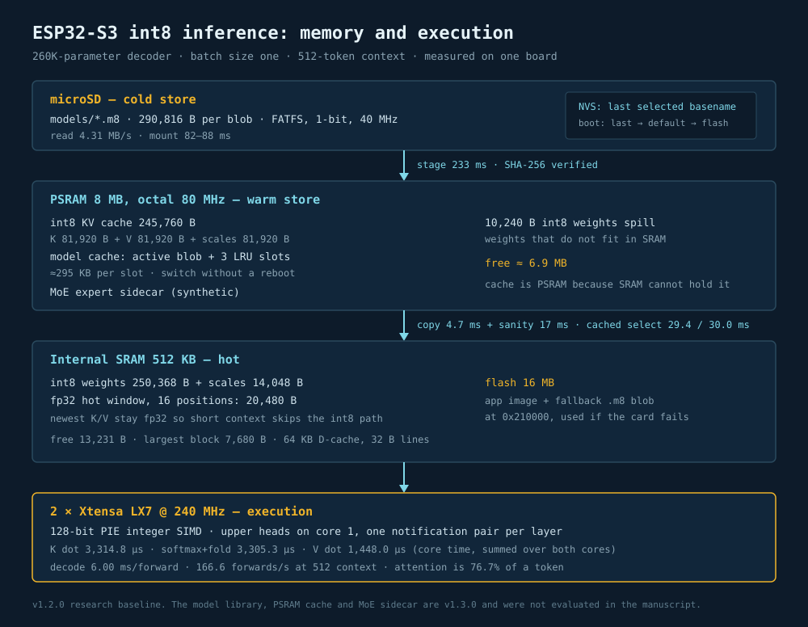

# ESP32-S3 INT8 Transformer Inference

[](https://doi.org/10.5281/zenodo.24555021)

Firmware, kernels and measurement tooling for running a small int8 transformer
entirely on an ESP32-S3, plus a model runtime that loads and switches models
from an SD card.

The research baseline (`v1.2.0`) is the exact code and configuration behind the
TECS experimental claims: an int8 KV cache in PSRAM and 128-bit PIE attention at
512-token context. The runtime release (`v1.3.0`) adds the `.m8` model library,
a PSRAM cache, NVS boot selection and a synthetic MoE prototype. **`v1.3.0` was
not evaluated in the submitted manuscript.**



## Platform

| | |
|---|---|
| SoC | ESP32-S3, dual-core Xtensa LX7, 240 MHz, silicon v0.2 |
| Internal SRAM | 512 KB |
| PSRAM | 8 MB octal, 80 MHz |
| Flash | 16 MB |
| Model | 260K parameters, 512-token vocabulary, 512-token context |
| Toolchain | ESP-IDF v5.4.4 |

## Releases

| Tag | Role | Headline |
|---|---|---|
| `v1.2.0` | Research baseline | 166.6 decode forwards/s (168.25 sampled tokens/s) at 512 context; 2.898x sampled-rate improvement over the 58.06 tok/s fp32 single-core baseline; 245,760 B int8 KV payload and scales |
| `v1.3.0` | Runtime evolution | `.m8` model library, three-slot PSRAM cache, NVS selection, synthetic MoE sidecar |
| `v1.3.1` | Metadata patch | Corrected citation metadata, provenance document and explicit rate labels; firmware byte-identical to `v1.3.0` |

`v1.2.0` is the release that corresponds to the research results. `v1.3.0`
builds on it without changing the evaluated kernels or the measured claims.
`v1.3.1` changes documentation and metadata only. It is archived by Zenodo as
[10.5281/zenodo.24555021](https://doi.org/10.5281/zenodo.24555021); the concept
DOI [10.5281/zenodo.24555020](https://doi.org/10.5281/zenodo.24555020) resolves
to the latest version. `v1.2.0` and `v1.3.0` predate the Zenodo integration and
are not archived there.

This repository is a filtered export of a private research tree, so the commit
IDs are not the original ones. The tag mapping, the files that were reworded and
the byte-for-byte verification are in
[`docs/RELEASE-PROVENANCE.md`](docs/RELEASE-PROVENANCE.md).

## Layout

```
firmware/   ESP-IDF project: attention kernels, int8 KV cache, model runtime, tokenizer
micro/      standalone microbenchmark and ESP-DSP comparison
tools/      analysis, capture, packing, verification, reference and figure scripts
config/     sdkconfig snapshots for the 32 KB and 64 KB D-cache variants
data/       expected outputs and reference metadata
logs/       raw benchmark captures and runtime test logs
model/      model provenance, tokenizer and licences
docs/       hardware, reproduction, model library, SD benchmark and provenance documentation
```

## Quick start

The research configuration is the 64 KB D-cache build:

```bash
. $IDF_PATH/export.sh
cd firmware
idf.py set-target esp32s3
cp ../config/sdkconfig.64kb sdkconfig
idf.py build
idf.py -p /dev/ttyACM0 flash monitor
```

The 32 KB build is the cache-sweep baseline, not the headline configuration.

The model runtime tools build and verify `.m8` blobs:

```bash
python3 tools/pack_model_m8.py --help
python3 tools/verify_m8.py --help
python3 tools/make_moe_sidecar.py --help
```

## Results at a glance

All values are measured on the board above; the raw captures are in `logs/`.
The two groups answer different questions and are not comparable with each
other.

### v1.2.0 — research benchmark results

Fixed 512-token context, batch size one, greedy sampling, same harness in every
cell. These are the numbers behind the TECS experimental claims.

| Metric | Value |
|---|---|
| Decode forwards/s at 512 context | 166.6 |
| Sampled tokens/s, same harness | 168.25 |
| Sampled-rate speed-up vs fp32 single core (58.06 tok/s) | 2.898x |
| Sampled-rate speed-up vs fp32 dual core (79.77 tok/s) | 2.109x |
| Decode forward time | 6.00 ms |
| int8 KV payload and scales (PSRAM) | 245,760 B |
| Complete hybrid cache incl. SRAM hot window | 266,240 B |
| PSRAM scan traffic | 238,080 B/token |
| Scan bandwidth | 51.7 MB/s |
| Attention share of a token | 76.7% |

Accuracy: top-1 predictions match the fp32 reference at all nine evaluation
depths; combined relative logit RMSE is 1.08% to 4.56%, and cosine similarity is
at least 0.9995052.

Six independent captures of the final build span 168.24-168.28 sampled tokens/s
(166.60-166.64 decode forwards/s). 168.25 is the tabulated value, not a selected
best run.

### v1.3.0 — model runtime measurements

These describe the runtime layer added after the manuscript was submitted.
**They were not evaluated in the manuscript and are not claims about the
evaluated kernels.**

| Metric | Value |
|---|---|
| `.m8` blob | 290,816 B |
| Cold model select (SD -> PSRAM -> SRAM) | 377.6 ms |
| Cached model select | 29.4 / 30.0 ms |
| LRU cache, eight selects | 8/8 correct, 3 slots |
| MoE, pinned expert | 1.00x latency (no penalty) |
| MoE, natural synthetic router | ~1.9x latency (~2,430 vs 1,266 us, estimated) |
| MoE, round-robin worst case | 3.33x latency (4,222 vs 1,266 us) |
| Expert refill from PSRAM | 58-60 MB/s |

MoE rows are per-forward latency relative to the same build with no MoE; a
larger number is slower. The natural-router figure is an estimate, and the
fixture is synthetic: no quality or routing claim is made.

## Reproducing the results

The logs are the raw UART captures the results are computed from. The analysis
scripts recompute the tables and figures from those logs:

```bash
python3 tools/analyze_bench.py
python3 tools/make_figures.py
python3 tools/micro_report.py
```

Verify the tree against the release manifest:

```bash
sha256sum -c MANIFEST.sha256
```

Re-running the firmware needs an ESP32-S3 with octal PSRAM, a microSD card and
ESP-IDF v5.4.4. Throughput depends on cache size and line size, so the cache
configuration is part of the experiment, not an implementation detail.

## Scope and limitations

### v1.2.0 — research claims

- The 260K checkpoint writes simple children's-story English. It is a reflex-tier
  runtime, not an assistant.
- All measurements come from one ESP32-S3-CAM, silicon v0.2, 8 MB octal PSRAM.
  The board vendor and revision were not marked and were not recorded.
- Energy per token was not measured; no energy or thermal claim is made.
- Accuracy is top-1 and logit agreement with the fp32 reference, not a
  downstream task benchmark.
- Throughput depends on D-cache size and line size; the cache configuration is
  part of the experiment, not an implementation detail.

### v1.3.0 — runtime

- Not evaluated in the submitted manuscript. These measurements time a model
  switch, not token generation, and are not comparable with the research rate.
- Runtime switching requires identical tensor shapes and tokenizer. Models with
  different shapes still require a reboot.
- The MoE prototype is synthetic: two experts, no training, no quality or
  routing claim.
- Per-token expert paging from SD is not viable at the measured card rate.
- Untested: card removal mid-read, power loss during a switch, a real
  different-shape blob on device, NVS erased or full, and the Wi-Fi download
  path. See §13 of [`docs/MODEL-LIBRARY-DESIGN.md`](docs/MODEL-LIBRARY-DESIGN.md).

## Citation

See `CITATION.cff`.

## Licence

- Firmware, tools and build configuration: **GPL-3.0-only**, see `LICENSE`.
- Bundled 260K model and tokenizer: **MIT**, see `model/LICENSE` and
  `model/PROVENANCE.md`.
- Documentation and figures: **CC BY 4.0**, see `LICENSE-PAPER`.
